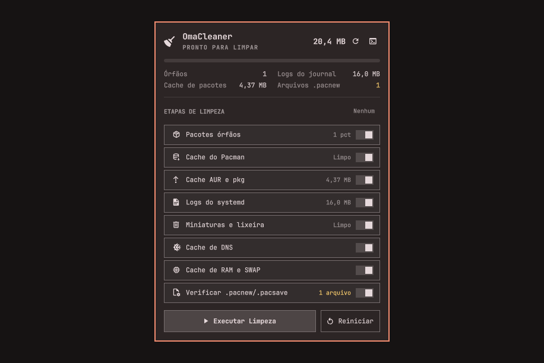

# OmaCleaner

A native [Omarchy](https://omarchy.org) shell bar widget and keyboard-driven panel for deep Arch Linux system cleanup.



## Features

- **Live system snapshot** when opened: orphan package count, Pacman + AUR cache sizes, `systemd` journal usage, user thumbnails/Trash size, and pending `.pacnew`/`.pacsave` files.
- **Selectable cleanup steps**:
  1. **Orphan packages** — removes unused dependencies via `pacman -Rns`.
  2. **Pacman cache** — runs `paccache -rk2` & `paccache -ruk0` (falls back to `pacman -Sc`).
  3. **AUR & pkg cache** — cleans `yay`/`paru` AUR caches (unprivileged) and empties `/var/cache/pacman/pkg/*`.
  4. **Systemd journal** — vacuums logs to `100M` and `7d`.
  5. **Thumbnails & Trash** — clears `~/.cache/thumbnails` and `~/.local/share/Trash`.
  6. **DNS cache** — flushes `systemd-resolved`, `dnsmasq`, or `nscd` when active.
  7. **RAM cache & SWAP** — runs `sync`, drops kernel caches (`drop_caches`), and recycles active SWAP (including systemd-managed `zram`).
  8. **`.pacnew` / `.pacsave` check** — scans `/etc` and highlights files needing review with `pacdiff`.
- **Single native Polkit prompt** — bundles all selected root steps into a single `pkexec` call using Omarchy's built-in Polkit agent while user steps run unprivileged.
- **Floating terminal mode** — launch the selected steps interactively inside Omarchy's floating terminal (`omarchy-launch-floating-terminal-with-presentation`).
- **Safe double-click reboot** — requires a second confirmation click within 4 seconds.
- **Theme, motion & language aware** — follows your active Omarchy theme, animations toggle, and language (`en`, `pt-BR`, `pt`).
- **Zero idle overhead** — no background timers or polling while the panel is closed.

## Installation

```bash
omarchy plugin add https://github.com/ArchGuima/omarchy-clear-arch --enable
omarchy bar put archguima.omacleaner --section right
```

## Removal

```bash
omarchy plugin remove archguima.omacleaner
```

## Keyboard Shortcuts & IPC

Inside the open panel:

| Key | Action |
| --- | --- |
| `↑` / `↓` or `j` / `k` | Navigate steps and action buttons |
| `Space` / `Enter` | Toggle step or activate button |
| `a` | Select all / none |
| `r` | Rescan system |
| `l` | Show / hide live log |
| `Tab` | Switch to neighboring bar panel |
| `Esc` | Close panel |

You can also bind a Hyprland hotkey to toggle the panel via IPC:

```bash
omarchy-shell archguima.omacleaner toggle
```

## Dependencies & Privileges

- **Required:** `pacman`, `pkexec` (`polkit`), `systemd`, `bash` (all standard on Omarchy / Arch Linux).
- **Optional:** `pacman-contrib` (`paccache`), `yay` or `paru`.
- **Privileges:** Only the read-only scan and `Thumbnails & Trash` / AUR helper cleanup run as your normal user. Administrative tasks run via `pkexec` through `scripts/omacleaner-root.sh`, which validates every requested step against a strict allowlist before executing.

## License

MIT — see [LICENSE](LICENSE).
